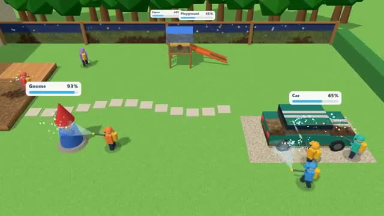

# Power Wash Crew

Blast a filthy backyard clean. Ding at 100%! A multiplayer starter game from [Multiplayer Agent](https://multiplayeragent.com): 3D, co-op, 1–4 players, with bots that fill empty seats.

## How it plays

Spray the fence, deck, car, gnome and playground until each one dings at 100%. The wide fan clears grime fast, but caked mud needs the turbo jet; clean the whole yard together for three stars.

**Controls:** WASD to walk, hold the mouse on dirt to spray, Q or right-click to switch nozzle; touch: left thumb walks, touch dirt to spray, FAN/JET button.

## Make it yours in the Game Builder

Open the [Game Builder](https://multiplayeragent.com), choose **Start from a starter game** and pick Power Wash Crew. It opens as version 1 in your studio, ready to play and publish. Then ask for changes, for example:

- Add a soap nozzle that loosens caked mud so the fan can clear it
- Hide a gold coin under the dirt on every object
- Make it a pirate ship deck covered in barnacles

## Run it yourself

1. Get a free publishable key (`pk_…`) at [multiplayeragent.com](https://multiplayeragent.com).
2. In `index.html`, put it in place of `pk_REPLACE_ME` in the `MP_CONNECT` block.
3. Serve the folder with any static web server and open `index.html` (3D games load `libs/three.module.min.js` as a module, which browsers block from a plain file). No build step and no game server needed.

Without a key it still runs, offline against bots.

## How it is built

- One `index.html` plus three.js in `libs/`. The comment at the top of the script maps the code and explains the multiplayer.
- **Host-run rules:** The host's browser keeps every object's dirt, dings finished objects and runs the clock; if it leaves, the next player takes over.
- **Live sync:** Everyone sees the same dirt wash away as anyone sprays: your own spray shows at once.
- **Bots:** Bot washers pick a surface and sweep it row by row until enough people join.
- **Leaderboard:** The most grime each player blasted in one yard.
- **Live ops:** Make every nozzle stronger with no new deploy; an event's title shows on screen.
- `?attract` runs it offline with bots only. The preview video is recorded from it.

## License

MIT.
